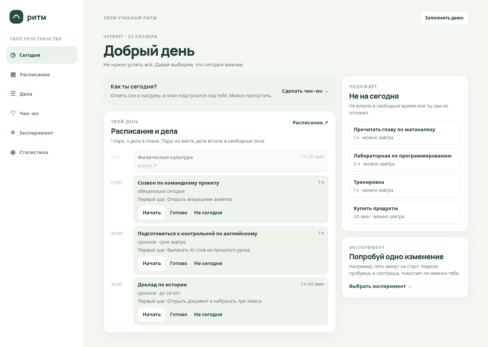

# Ритм

Сайт: https://tenkawaa.github.io/ritm/



## Что такое «Ритм»

«Ритм» — личное приложение для студента, которое объединяет расписание, учебные дела и наблюдения за самочувствием в одном месте. Оно помогает разбивать большие задачи на небольшие первые шаги и замечать, как сон и учебная нагрузка связаны с настроением.

## Проблема

Расписание, дедлайны и самочувствие студентов часто хранятся в разных местах. Большие задачи откладываются, а перегрузка становится заметна слишком поздно.

«Ритм» помогает планировать день с учётом занятий, дел и собственного состояния, не пытаясь успеть всё сразу.

## Как пользоваться

Основной сценарий работы с приложением:

1. **Собрать день.** Загрузить расписание из Google-таблицы вуза (по ссылке, с выбором курса и группы) или добавить занятия вручную. Перед сохранением приложение показывает распознанные пары, их можно поправить. Записать учебные и личные дела, указать их длительность, важность и дедлайны.
2. **Посмотреть план на сегодня.** Занятия учитываются как фиксированные события, а гибкие дела распределяются по свободному времени. При плохом сне или высокой нагрузке план становится легче: дел меньше, а между ними есть паузы.
3. **Начать с первого шага.** Для большой задачи определить небольшое действие, которое поможет приступить к работе.
4. **Заполнить чек-ин.** Примерно за 30 секунд отметить настроение, продолжительность сна и уровень нагрузки.
5. **Провести эксперимент.** Выбрать одно изменение на неделю, отмечать энергию и оценивать, помогает ли оно.
6. **Посмотреть статистику.** Изучить накопленные данные и понаблюдать за связью сна, настроения и нагрузки.

## Вкладки приложения

- **Сегодня** — план дня: занятия, дела в свободных окнах и первый шаг к ним. Можно отложить дело на завтра.
- **Расписание** — загрузка из таблицы вуза, просмотр по неделям и редактирование занятий с датами, временем, преподавателями и аудиториями.
- **Дела** — список задач, длительность, важность, дедлайны, регулярность и первые шаги.
- **Чек-ин** — ежедневные отметки настроения, сна и нагрузки.
- **Эксперимент** — проверка личных привычек, ежедневные отметки энергии и итог эксперимента.
- **Статистика** — графики и наблюдения по истории чек-инов за неделю, месяц или семестр, контакты поддержки, скачивание и удаление своих данных.

## Приватность

- Данные хранятся в `localStorage` браузера на устройстве пользователя.
- Серверная часть отсутствует. Приложение не требует регистрации или аккаунта.
- Данные можно скачать для резервного копирования, а при необходимости — удалить.
- При очистке данных браузера или смене устройства сохранённые данные могут стать недоступны. Рекомендуется периодически делать резервную копию.
- Выводы по статистике отражают личные наблюдения, а не медицинские заключения. Совпадение изменений сна, настроения и нагрузки не доказывает причинно-следственную связь.

## Технологии

- **Vue 3** — интерфейс приложения и реактивное управление состоянием.
- **Vite** — локальная разработка и сборка проекта.
- **localStorage** — сохранение расписания, дел, чек-инов и экспериментов.
- **CSS** — оформление интерфейса и построение графиков.
- **GitHub Pages** — публикация сайта. Он собирается и обновляется сам через GitHub Actions после каждого изменения в `main`.

## Как запустить

Требуется установленный Node.js и npm.

Установить зависимости:

```bash
npm install
```

Запустить локально:

```bash
npm run dev
```

После этого открыть http://localhost:5173. Кнопка «Заполнить демо» в правом верхнем углу заполняет приложение примером: расписанием, делами, чек-инами и прошлым экспериментом.

Собрать проект:

```bash
npm run build
```

## Ограничения

- Загрузка расписания по ссылке зависит от того, как Google отдаёт таблицу. Если она не сработает, таблицу можно скачать как CSV и загрузить файлом.
- Подсказки и план дня построены на простых правилах, это не рекомендации специалиста.
